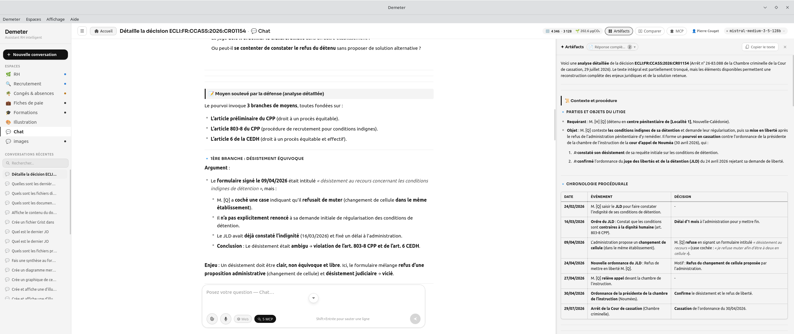
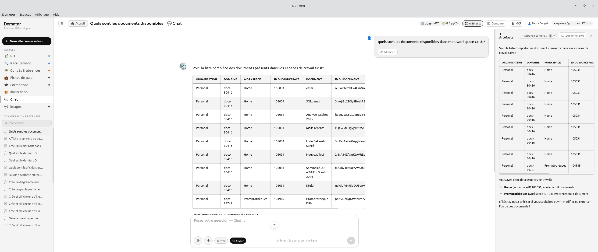
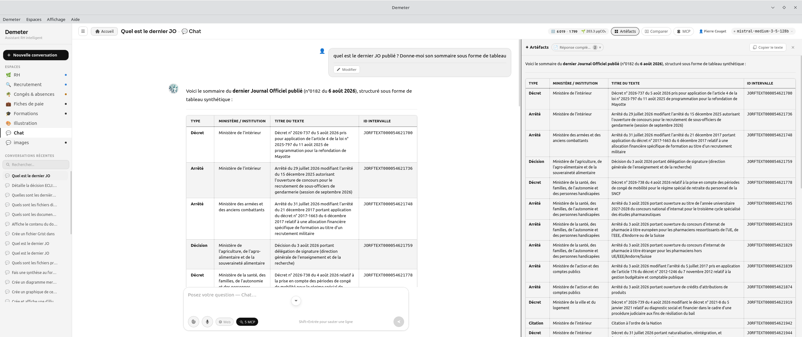
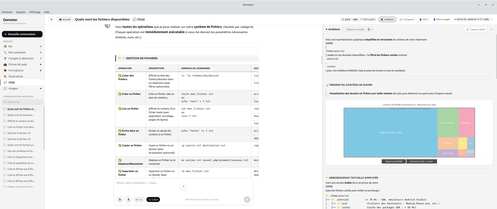

# demeter-mcp-pack

[](LICENSE)
[](https://www.rust-lang.org/)
[](https://modelcontextprotocol.io/)
[](https://piste.gouv.fr)

---

`demeter-mcp-pack` rassemble, compile et publie les serveurs [MCP](https://modelcontextprotocol.io/) officiels de [Demeter](https://github.com/Ktulu-Analog/demeter) : **Judilibre**, **Grist**, **Légifrance**, **Génération d'images** (ComfyUI) et **Système de fichiers**. Écrits en Rust, ils tournent aussi bien en transport **HTTP Streamable** qu'en **stdio** — utilisables tels quels avec Demeter, mais aussi avec Claude Desktop, Claude Code, ou tout autre client MCP.

---

## Détail des serveurs

### `mcp-judilibre`



Donne accès à la base de jurisprudence judiciaire ouverte de la Cour de cassation via l'API [JUDILIBRE](https://www.judilibre.io/) (PISTE) : recherche plein texte paginée, récupération d'une décision complète par identifiant, export en masse, taxonomie des champs/filtres, statistiques, historique transactionnel. **8 outils**. Portage Rust d'un projet Python original — binaire unique, sans dépendance runtime.

### `mcp-grist`



Lecture et écriture d'un espace [Grist](https://www.getgrist.com/) (tableur collaboratif façon Airtable) : organisations, workspaces, documents, tables, colonnes, enregistrements (CRUD complet), et exécution de requêtes SQL en lecture sur un document. **18 outils**, répartis en six catégories (organisations, documents, tables, colonnes, enregistrements, SQL).

### `mcp-legifrance`



Codes et textes en vigueur et leurs articles (avec versions et liens de concordance), lois et règlements (LODA), Journal Officiel (derniers numéros, sommaires par date), conventions collectives (KALI), jurisprudence administrative et judiciaire, délibérations CNIL, accords d'entreprise, dossiers et débats parlementaires. **63 outils**, via l'API Légifrance (PISTE).

### `mcp-system`



Accès en lecture/écriture au système de fichiers local depuis un assistant IA : parcours, lecture/écriture, copie/déplacement/suppression (unitaire ou en lot), recherche, calcul d'empreintes, archives, permissions. **33 outils**, volontairement restreints : écriture et suppression limitées au répertoire `$HOME`, noms de fichiers sensibles bloqués (`.env`, `.ssh`, `id_rsa`, `passwd`, `shadow`, `.aws`, `credentials`, `.gnupg`…), variables d'environnement sensibles masquées dans `system_info`.

### `mcp-image`


Pont entre un assistant IA texte et une instance [ComfyUI](https://github.com/comfyanonymous/ComfyUI) locale ou distante (Stable Diffusion et dérivés) : génère une image à partir d'un prompt et la retourne directement dans la conversation, liste les modèles `.safetensors` disponibles. **2 outils**, largement configurables par variables d'environnement (dimensions, steps, CFG, sampler, scheduler, prompt négatif par défaut…). Nécessite une instance ComfyUI déjà installée et démarrée.

---

Chaque serveur a par ailleurs sa propre version HTTP-only historique, documentée séparément :
[`mcp-judilibre`](https://github.com/Ktulu-Analog/mcp-judilibre) · [`mcp-legifrance`](https://github.com/Ktulu-Analog/mcp-legifrance)

---

## Contenu

| Serveur | Description | Identifiants requis |
|---|---|---|
| `mcp-judilibre` | Jurisprudence judiciaire (Cour de cassation, cours d'appel, tribunaux judiciaires) — API JUDILIBRE | PISTE (gratuit) |
| `mcp-grist` | Lecture/écriture d'un tableur [Grist](https://www.getgrist.com/) — organisations, documents, tables, enregistrements | Clé API Grist |
| `mcp-legifrance` | Codes, lois, Journal Officiel, conventions collectives, jurisprudence administrative — API Légifrance | PISTE (gratuit) |
| `mcp-system` | Lecture/écriture du système de fichiers local (répertoire HOME), restreint et sans accès aux chemins sensibles | Aucun |
| `mcp-image` | Génération d'images par IA via une instance [ComfyUI](https://github.com/comfyanonymous/ComfyUI) locale ou distante (Stable Diffusion et dérivés) | Aucun (nécessite une instance ComfyUI démarrée) |

Chaque serveur a par ailleurs sa propre version HTTP-only historique, documentée séparément :
[`mcp-judilibre`](https://github.com/Ktulu-Analog/mcp-judilibre) · [`mcp-legifrance`](https://github.com/Ktulu-Analog/mcp-legifrance)

---

## Fonctionnement avec un seul dépôt

Ce dépôt fonctionne en **monorepo** : les 5 serveurs vivent directement dans `sources/`, dans ce même dépôt. C'est le mode par défaut, et il n'y a rien à faire pour l'activer — c'est déjà comme ça.

C'est le choix le plus simple : un seul dépôt à cloner, un seul historique, un seul endroit où ouvrir une issue, pas de submodules à synchroniser.

Construction des binaires : `scripts/build-all.sh`, `scripts/package.sh`.


### Fonctionnement avec des dépôts séparés par serveur

Si chaque MCP doit avoir son propre dépôt (versionnage indépendant, contributeurs différents, visibilité individuelle sur GitHub), migration possible vers des **submodules git** :

```bash
for dir in sources/*/; do rm -rf "$dir"; done
git submodule add https://github.com/Ktulu-Analog/mcp-judilibre-rs.git   sources/mcp-judilibre-rs
git submodule add https://github.com/Ktulu-Analog/mcp-grist-rs.git      sources/mcp-grist-rs
git submodule add https://github.com/Ktulu-Analog/mcp-legifrance-rs.git sources/mcp-legifrance-rs
git submodule add https://github.com/Ktulu-Analog/mcp-system-rs.git      sources/mcp-system-rs
git submodule add https://github.com/Ktulu-Analog/mcp-image-rs.git      sources/mcp-image-rs
git commit -am "sources: passage en submodules git"
```

Rien d'autre ne change : `scripts/build-all.sh`, `scripts/package.sh` et le workflow CI fonctionnent à l'identique dans les deux cas — ils ne regardent que le contenu de `sources/`, peu importe comment il y est arrivé.

---

## Structure

```
demeter-mcp-pack/
├── mcp-servers/                  ← ce qui est effectivement distribué
│   ├── mcp-judilibre/
│   │   ├── manifest.json         ← id, params attendus, chemins des binaires
│   │   └── bin/                  ← rempli par la CI (vide dans git)
│   ├── mcp-grist/
│   ├── mcp-legifrance/
│   ├── mcp-system/
│   └── mcp-image/
├── sources/                      ← code source Rust de chaque serveur
│   ├── mcp-judilibre-rs/
│   ├── mcp-grist-rs/
│   ├── mcp-legifrance-rs/
│   ├── mcp-system-rs/
│   └── mcp-image-rs/
├── scripts/
│   ├── build-all.sh              ← compile les 5 serveurs pour UNE plateforme
│   └── package.sh                ← assemble les archives de release + checksums
├── .github/workflows/release.yml ← CI : matrice 2 plateformes → GitHub Release
└── VERSION                       ← version courante du pack (semver)
```

---

## Build local

```bash
# Une plateforme à la fois (celle de votre machine, en général)
./scripts/build-all.sh linux-x64 x86_64-unknown-linux-gnu
# macOS Apple Silicon : ./scripts/build-all.sh macos-arm64 aarch64-apple-darwin
# macOS Intel :         ./scripts/build-all.sh macos-x64   x86_64-apple-darwin
# Windows :              scripts\build-all.sh windows-x64  x86_64-pc-windows-msvc

# Puis, une fois tous les binaires voulus présents dans mcp-servers/*/bin/ :
./scripts/package.sh
```

Les archives et `checksums.txt` sont générées dans `dist/`.

---

## Cycle de vie d'une release

1. On modifie directement le code d'un serveur dans son dossier (`sources/mcp-grist-rs/`…).
2. On incrémente `VERSION` à la racine (semver).
3. On pousse un tag `vX.Y.Z` → la CI (`.github/workflows/release.yml`) :
   - compile les 5 serveurs pour les 2 plateformes couvertes par la CI (`linux-x64`, `windows-x64` — le build macOS reste possible en local via `scripts/build-all.sh`, voir ci-dessus) ;
   - assemble un pack combiné (`mcp-pack-X.Y.Z.zip`) **et** une archive par serveur (`mcp-grist-X.Y.Z.zip`…) — utile pour un usage hors Demeter, par exemple dans Claude Desktop ;
   - publie le tout, avec un `checksums.txt` (SHA-256), en [GitHub Release](../../releases).

Un seul dépôt à faire évoluer pour ajouter, corriger ou mettre à jour un MCP officiel — sans dépendre d'une nouvelle release de Demeter.

---

## Ajouter un nouveau MCP au pack

1. Ajoutez les sources dans `sources/mcp-mon-nouveau-serveur/` (ou en submodule, voir plus haut).
2. Créez `mcp-servers/mcp-mon-nouveau-serveur/manifest.json` (voir un manifest existant comme modèle : `id`, `name`, `description`, `bin`, `args`, `params`).
3. Ajoutez l'entrée correspondante dans `SERVERS` (`scripts/build-all.sh`) et dans la liste `zip` de `scripts/package.sh`.
4. Tag + push → la CI se charge du reste.

---

## Utilisation par Demeter

Côté [Demeter](https://github.com/Ktulu-Analog/demeter), `src-tauri/mcp-servers/` n'est pas versionné en dur : un script (`scripts/fetch-mcp-pack.sh`) télécharge l'archive `mcp-pack-<version>.zip` d'un tag **épinglé** de ce dépôt, vérifie son empreinte SHA-256, et la décompresse avant `tauri build`.

À l'exécution, le bouton **"Mettre à jour"** du panel MCP de Demeter interroge la dernière release publiée ici et propose une mise à jour ponctuelle (téléchargement, vérification, installation non-destructive), sans attendre une nouvelle version de Demeter.

---

## Licence

[GNU Affero General Public License v3.0](LICENSE) — © 2026 Pierre COUGET

## Disclaimer

Ce dépôt assemble et publie des serveurs MCP développés pour mes propres besoins avec Demeter. Ce ne sont pas des projets officiels des éditeurs des API qu'ils consomment (JUDILIBRE, Légifrance, Grist). Utilisation dans le respect des conditions d'utilisation de chaque API tierce.
